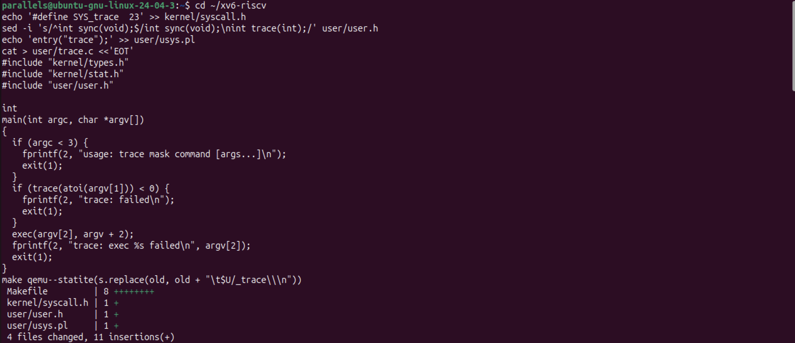
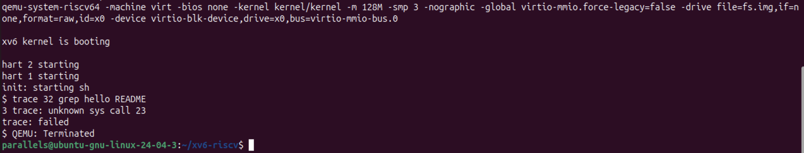
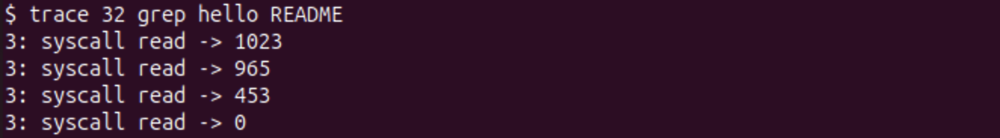
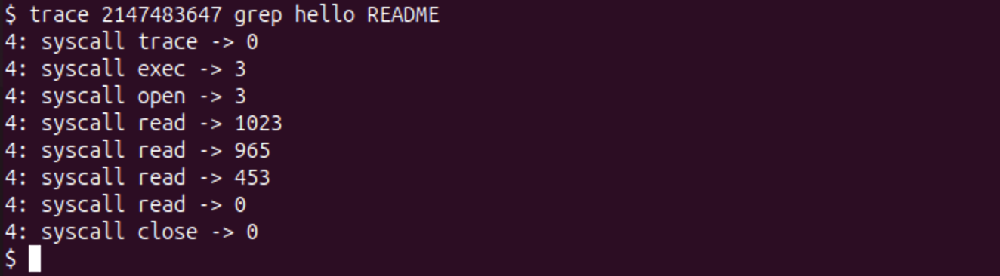
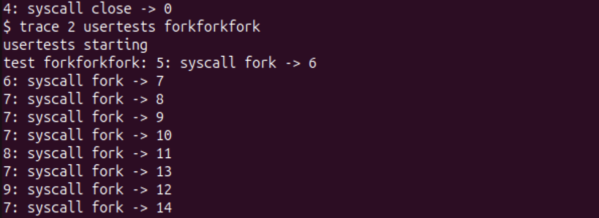
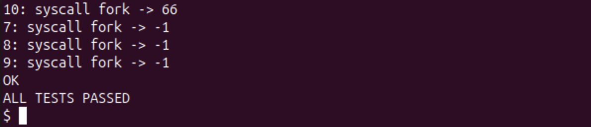
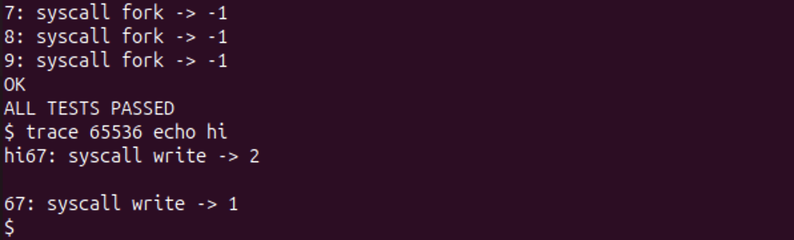
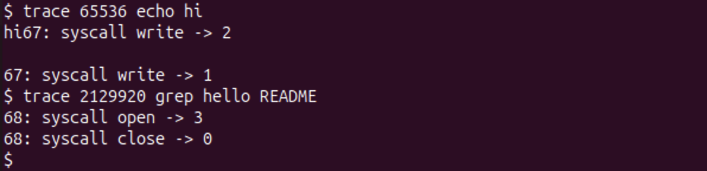

# Lab 10. Add Your Own System Call: trace

**Student:** Augustin Carazanu, FAF-243
**Environment:** Ubuntu 24.04.3 ARM64 in Parallels, xv6-riscv (course revision 06aad25), folder `~/xv6-riscv`

All changes of xv6 are in `lab10.patch` (a diff against revision 06aad25). The user program is `trace.c`; the answers are in `notes.txt`.

Two differences from the MIT instructions: in our tree number 22 is already `sync`, so the new call is **23**, and the kernel print function is `printk`, not `printf`.

## Part 1. The number and the user side

Five edits: `#define SYS_trace 23` in `kernel/syscall.h`, `int trace(int);` in `user/user.h`, `entry("trace");` in `user/usys.pl`, the new program `user/trace.c` and the line `$U/_trace\` in `UPROGS` of the `Makefile`.

*Figure 1.1 – the Part 1 edits applied; `git diff --stat`: 4 files, 11 insertions. The Makefile shows 8 insertions because it already contained the programs of earlier labs; only `$U/_trace\` is new. The odd `make qemu--statite(...` line is a leftover of the terminal paste.*

**Check 1** (the kernel does not know number 23 yet):

*Figure 1.2 – `3 trace: unknown sys call 23` and `trace: failed`: the user side reaches the kernel, the kernel side is still missing.*

## Part 2. The kernel side

- `kernel/proc.h`: field `int trace_mask;` in `struct proc`
- `kernel/sysproc.c`: `sys_trace()` reads argument 0 with `argint` and stores it in `myproc()->trace_mask`
- `kernel/syscall.c`: `extern uint64 sys_trace(void);`, the entry `[SYS_trace] = sys_trace`, the table `syscallnames[]`, and after the call `if ((p->trace_mask >> num) & 1) printk("%d: syscall %s -> %ld\n", p->pid, syscallnames[num], p->trapframe->a0);`
- `kernel/proc.c` (`kfork`): `np->trace_mask = p->trace_mask;`

**Check 2:**

*Figure 2.1 – `trace 32 grep hello README` prints only the four `read` calls (1023, 965, 453, 0).*

## Part 3. Play with the mask

**3.1 All the calls (mask 2147483647):**

*Figure 3.1 – `trace -> 0` (its own call), `exec -> 3`, `open -> 3`, four `read`, `close -> 0`, all with pid 4.*

**3.2 Only fork (mask 2):**

*Figure 3.2a – the beginning of `trace 2 usertests forkforkfork`: many different pids print `fork` lines.*

*Figure 3.2b – the end: the table is full, `fork` returns -1, `OK`, `ALL TESTS PASSED`.*

**3.3 Only write (mask 65536):**

*Figure 3.3 – `hi67: syscall write -> 2`, an empty line, `67: syscall write -> 1`.*

**3.4 Open and close (mask 2129920):**

*Figure 3.4 – only `68: syscall open -> 3` and `68: syscall close -> 0`.*

## Observe

**1. In `trace 32 grep hello README` why do you see only `read`, and not `open` or `close`?**
The mask 32 is 2^5, so only bit 5 is on, and 5 is `read`. The kernel prints a call only if `(p->trace_mask >> num) & 1` is 1. `grep` still calls `open` and `close` (Figure 3.1), but bits 15 and 21 are off.

**2. In `forkforkfork`, three different pids print lines. Which line of code from Part 2 makes that possible?**
`np->trace_mask = p->trace_mask;` in `kfork()`. The child gets a copy of the mask, so every child and grandchild prints its own `fork` calls under its own pid. In my run even more pids print (5, 6, 7, 8, 9, 10, 32, 43, …).

**3. In `trace 65536 echo hi` the trace line is printed between "hi" and the new line. Why? How many times does `echo` call `write`?**
`echo` calls `write` **twice**: `hi` (2 bytes) and the new line (1 byte). The trace line is printed right after each call. After the first `write` the screen shows `hi`, so `67: syscall write -> 2` follows on the same line; its own `\n` ends the line, then the second `write` prints the empty line, and then `67: syscall write -> 1`.

**4. Which mask traces both `open` (15) and `close` (21), and nothing else?**
2^15 + 2^21 = 32768 + 2097152 = **2129920** (Figure 3.4).

## Conclusions

I added `trace` to xv6 and followed the number 23 through all its stops: `syscall.h`, `user.h`, the stub made by `usys.pl` (`li a7, SYS_trace; ecall; ret`), the `syscalls[]` table, `sys_trace` and the field `trace_mask`. The mask is a bitmask, so one number selects any set of calls. `exec` keeps the mask and `fork` copies it, which is why the traced command and all its children print their calls. The trace line is printed after the call has finished, which explains the order in `echo hi`.
