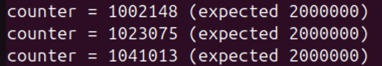
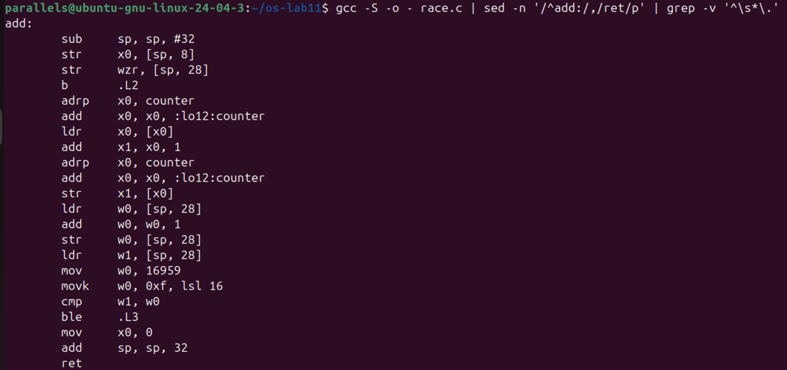
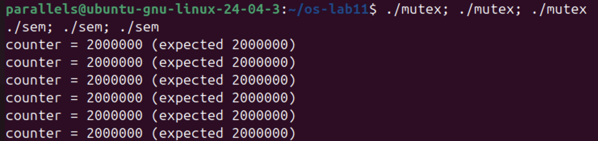
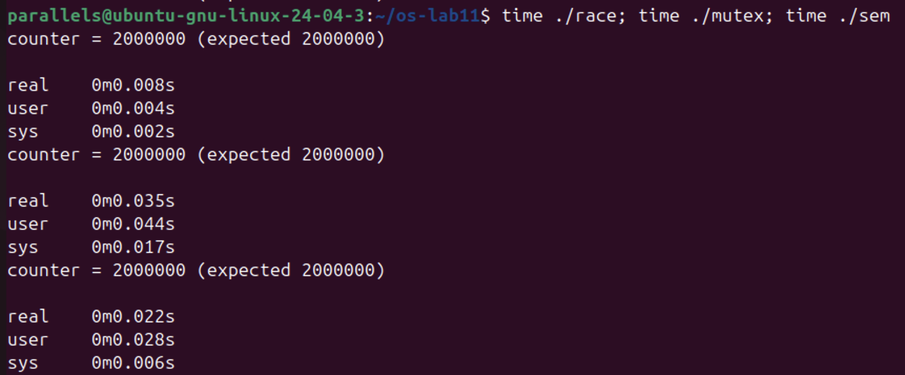
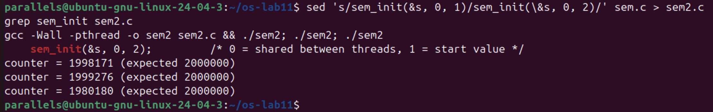
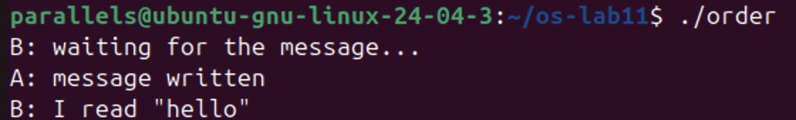
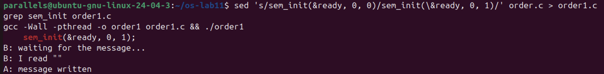
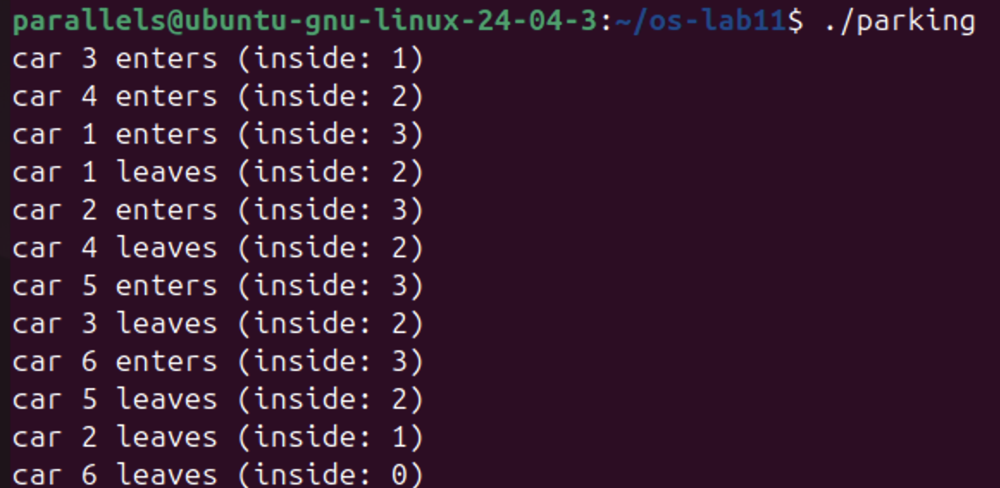
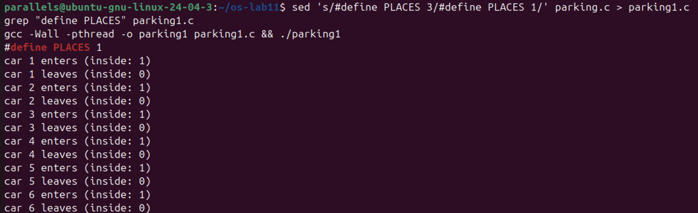
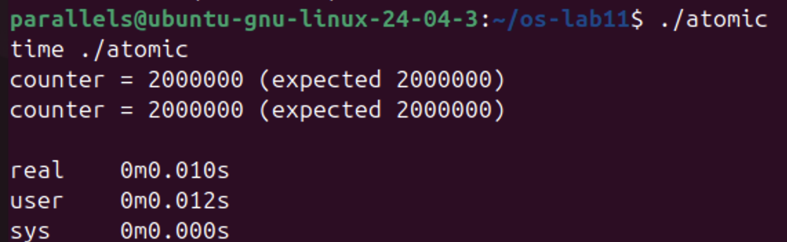

# Lab 11. The Race and the Semaphore

**Student:** Augustin Carazanu, FAF-243
**Environment:** Ubuntu 24.04.3 ARM64 (Parallels), folder `~/os-lab11`, all programs built with `gcc -Wall -pthread` (no `-O2`)

Files: `race.c`, `mutex.c`, `sem.c`, `order.c`, `parking.c`, optional `atomic.c`, and the copies used for the Observe experiments: `sem2.c` (start value 2), `order1.c` (start value 1), `parking1.c` (`PLACES 1`).

## Part 1. See the race

*Figure 1.1 – three runs of `./race`: 1002148, 1023075, 1041013 instead of 2000000.*

*Figure 1.2 – `gcc -S` of `add()`: `counter++` is `ldr x0, [x0]` / `add x1, x0, 1` / `str x1, [x0]`.*

**1. counter++ looks like one step. Write the three steps the CPU really does.**
1) read `counter` from memory into a register (`ldr`), 2) add 1 in the register (`add`), 3) write the register back to `counter` (`str`). The other thread can run between any two of them.

**2. Describe, with those steps, how two threads can lose one addition.**
`counter` is 5. A reads 5. B reads 5 before A writes. A adds 1 and writes 6. B adds 1 to its own copy and writes 6. Two additions, but `counter` grew by only 1: B's write covered A's. That is a race condition: both threads were in the critical section `counter++` at the same time.

**3. Why is the result different at every run?**
The interleaving of the threads changes at every run (when each thread starts, on which core, when the scheduler stops it), so the number of lost additions changes too. It can even be right by chance: in Figure 2.2 `race` printed 2000000, because that time one thread finished before the other started. A correct result once does not make the program correct.

## Part 2. Fix it: mutex, then semaphore

*Figure 2.1 – `./mutex` and `./sem`, three runs each: always 2000000.*

*Figure 2.2 – `time`: race 0.008 s, mutex 0.035 s, sem 0.022 s.*

*Figure 2.3 – `sem2.c` with `sem_init(&s, 0, 2)`: 1998171, 1999276, 1980180.*

**1. Run mutex and sem three times each. Is the answer always 2 000 000?**
Yes, all six runs gave 2000000. Only one thread can be between lock/unlock (or `sem_wait`/`sem_post`), so the three steps of `counter++` cannot be mixed any more (mutual exclusion).

**2. What would happen in sem.c with sem_init(&s, 0, 2)? Try it and explain.**
With two units both threads pass `sem_wait` at once, so two threads are in the critical section and the race is back: 1998171, 1999276, 1980180. Fewer additions are lost than in `race.c` because the threads overlap less (part of the time is spent in `sem_wait`/`sem_post`), but the result is still wrong. A semaphore is a lock only when it starts at 1.

**3. Why is the locked version slower?**
Every addition now also costs a lock and an unlock (atomic instructions, the lock variable moving between the two cores), a busy lock makes the other thread wait or even sleep in the kernel (`futex`, visible as `sys` time), and the threads no longer work on the counter in parallel. Mine: race 0.008 s, mutex 0.035 s, sem 0.022 s. Here `sem` was slightly faster than `mutex`, unlike the reference machine; such short times vary between runs, but both locked versions are clearly slower than the unprotected one.

## Part 3. A semaphore as a signal

*Figure 3.1 – `./order`: B waits about one second, then reads "hello".*

*Figure 3.2 – `order1.c` with `sem_init(&ready, 0, 1)`: B reads "" before A writes.*

**1. Change the start value to 1, compile, run. What does B read now, and why?**
B reads an empty string `""`, and `A: message written` comes after it. With start value 1 there is already a unit, so B's `sem_wait` does not block (1 → 0) and B reads while A is still in `sleep(1)`; the global array `message` is still all zeros. The order is no longer guaranteed.

**2. Put it back to 0. In one sentence: what does a semaphore that starts at 0 mean?**
It means "nothing is ready yet": whoever calls `sem_wait` waits until another thread signals with `sem_post` that it is ready.

## Part 4. A semaphore as a counter: the parking lot

*Figure 4.1 – `./parking`: 6 cars, 3 places; `inside` never above 3.*

*Figure 4.2 – `parking1.c` with `PLACES 1`: one car at a time.*

**1. What is the largest value of "inside" you see? Which line of code guarantees it?**
3. `sem_init(&places, 0, PLACES)` gives the semaphore 3 units and `sem_wait(&places);` at the start of `car()` takes one before a car enters; at 0 the fourth car blocks until a car leaves with `sem_post(&places)`. In Figure 4.1 car 2 entered only after car 1 left, car 5 after car 4, car 6 after car 3.

**2. Set PLACES to 1. What does the semaphore become?**
A lock (binary semaphore, like a mutex): one car inside at a time, `inside` is only 1 or 0.

## Optional: atomic

*Figure 5.1 – `./atomic`: 2000000, real 0.010 s.*

`atomic_fetch_add` does read, add and write as one indivisible step: always correct, 0.010 s against 0.035 s for the mutex.

## Conclusions

`counter++` is three steps (`ldr`, `add`, `str`), and two threads that interleave them lose work: about a million additions out of two million, a different number every run, and sometimes none by chance. A mutex (or a semaphore at 1) makes it a critical section and always gives 2000000, at the price of speed. The start value of a semaphore decides its role: 1 = lock, 2 = two threads inside (race again), 0 = signal (B waits for A), N = counter of free places (never more than 3 cars). For a single counter an atomic operation is correct and the fastest.
