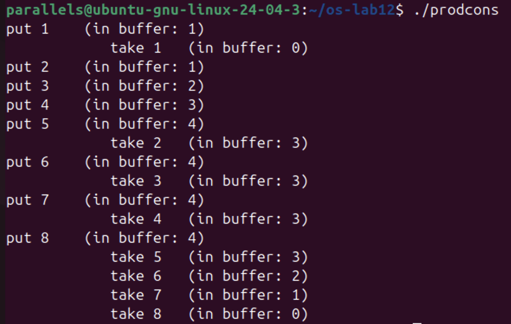
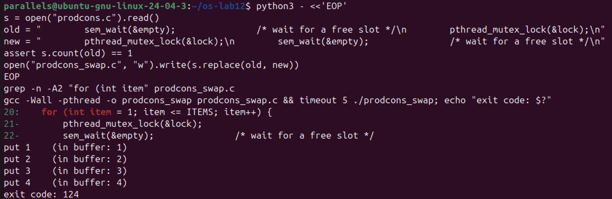
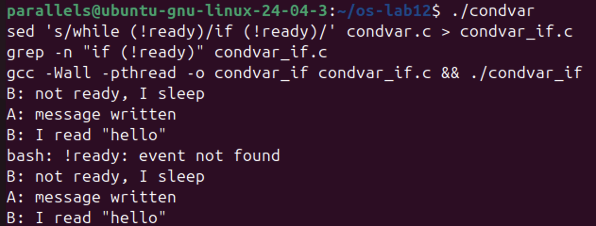
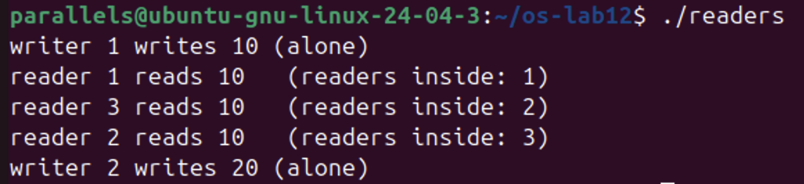
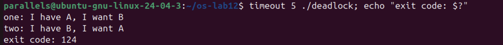
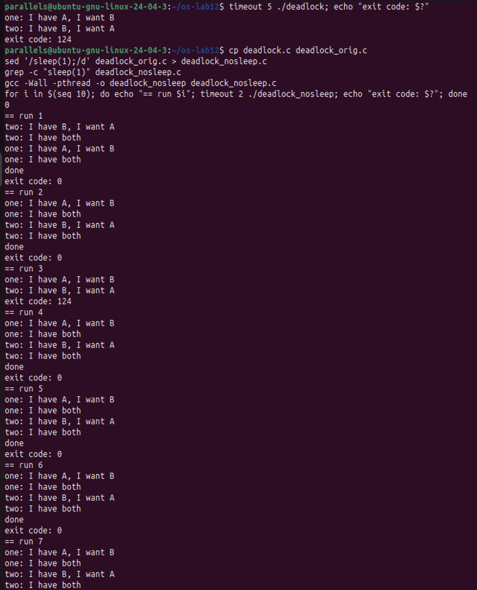
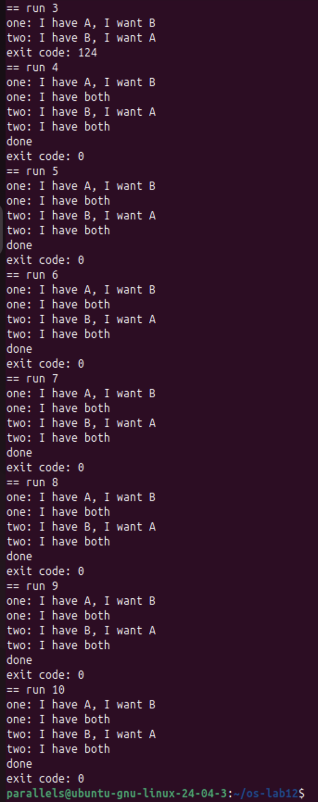
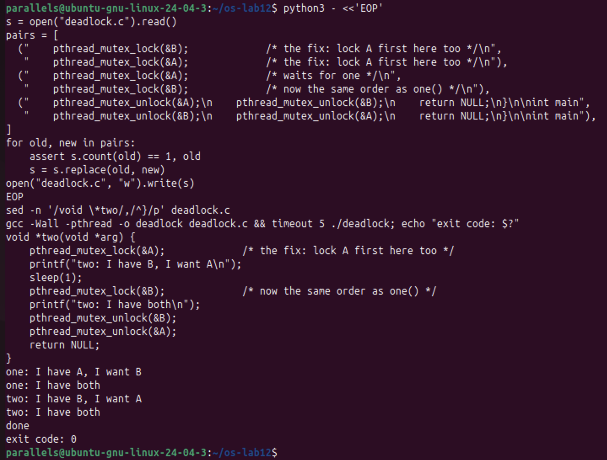

# Lab 12. Producer, Consumer and the Other Tools

**Student:** Augustin Carazanu, FAF-243
**Environment:** Ubuntu 24.04.3 ARM64 (Parallels), folder `~/os-lab12`, all programs built with `gcc -Wall -pthread`

Hand-in files: `prodcons.c`, `condvar.c`, `readers.c`, `deadlock.c` (the fixed version). Copies used for the Observe experiments: `prodcons_swap.c` (mutex before `sem_wait`), `condvar_if.c` (`if` instead of `while`), `deadlock_orig.c` (the original deadlock), `deadlock_nosleep.c` (original without `sleep(1)`).

## Part 1. Producer and consumer



*Figure 1.1 – `./prodcons`: `in buffer` never above 4.*



*Figure 1.2 – `prodcons_swap.c` (mutex locked before `sem_wait(&empty)`): `put 1`..`put 4`, then it hangs, `exit code: 124`.*

**1. The producer is fast, yet "in buffer" never goes above 4. Which call stops it?**
`sem_wait(&empty);` in `producer()`. `empty` starts at 4 and loses one unit per item; when the buffer is full it is 0 and the producer blocks until the consumer calls `sem_post(&empty)`. That is why `put 6` comes only after `take 2`, `put 7` after `take 3`, and so on.

**2. Who waits at the start: the consumer or the producer? Which call makes it wait?**
The consumer, in `sem_wait(&full);`, because `full` starts at 0. In my run it was already waiting, so it took item 1 right after `put 1` (`in buffer: 0`); then, while it slept, the producer filled items 2 to 5. (The sheet shows 4 puts first; the first lines depend on which thread runs first.)

**3. Lock the mutex BEFORE sem_wait(&empty). What happens when the buffer is full, and why?**
It prints `put 1`..`put 4` and hangs (`timeout` killed it, `exit code: 124`): a deadlock. With the buffer full the producer holds the mutex while it waits in `sem_wait(&empty)`; the consumer, who is the only one that can free a slot, blocks in `pthread_mutex_lock` on that same mutex. Each waits for the other forever. Rule: wait on the semaphore first, take the mutex only around the buffer, never sleep while holding a mutex.

## Part 2. The condition variable



*Figure 2.1 – `./condvar` and `./condvar_if` print the same three lines.* The line `bash: !ready: event not found` comes from my `grep "if (!ready)"` command (bash history expansion of `!` inside double quotes); only that `grep` failed, the `sed` with single quotes created `condvar_if.c` correctly and it was compiled and run.

**1. In order.c the semaphore itself remembered that the message was ready. Here, which variable remembers it?**
`ready`, the `int` protected by the mutex `lock`. The condition variable remembers nothing: a signal with no waiter is lost.

**2. Replace while (!ready) with if (!ready), compile, run. Does it still work here?**
Yes, the same three lines. One reader, one writer, `ready = 1` is set before the signal, so one check is enough here.

**3. Then why do we write while? Give one reason why a thread can wake up and still find ready == 0.**
Spurious wake-ups: POSIX allows `pthread_cond_wait` to return without any signal, with `ready` still 0. Also, with several waiters, another thread can take the mutex first after the signal, use the message and set `ready` back to 0. `while` re-checks and goes back to sleep.

## Part 3. Readers and writers



*Figure 3.1 – `./readers`: writer 1 alone, readers 1, 3, 2 inside together (1, 2, 3), writer 2 alone after them.*

**1. Which two lines of reader() make that possible?**
`if (++readers == 1) sem_wait(&room);` and `if (--readers == 0) sem_post(&room);`. Only the first reader takes the room and only the last gives it back, so readers share it while a writer (`sem_wait(&room)`) is always alone.

**2. Why does the counter readers need its own lock (rlock)? What could go wrong without it?**
`++readers`/`--readers` are read-modify-write, like `counter++` in Lab 11, and the test must go with the change. Without `rlock` two readers could both see 0 and both think they are first (the second then blocks forever on `room`), or the counter goes wrong when they leave: 0 too early lets a writer in during a read, never 0 locks the writers out forever.

**3. Readers keep arriving without a pause. What happens to writer 2?**
It waits forever: while any reader is inside, new readers enter without waiting for `room`, `readers` never returns to 0 and the room is never freed. That is starvation (fix: writer priority, e.g. a turnstile semaphore).

## Part 4. Build a deadlock, then remove it



*Figure 4.1 – `timeout 5 ./deadlock`: both "I have …, I want …" lines, then `exit code: 124`.*



*Figure 4.2 – `deadlock_nosleep` (original without `sleep(1)`), runs 1 to 7.*



*Figure 4.3 – runs 3 to 10: only run 3 got stuck (124), the other nine ended with 0.*



*Figure 4.4 – the fixed `deadlock.c` (`two()` locks A then B): `done`, `exit code: 0`.*

**1. In the stuck run, which thread holds which mutex, and which one is each thread waiting for? Draw the circle.**
`one` holds A and waits for B; `two` holds B and waits for A.

```
  one ---- waits for ---->  B
   ^                        |
   |                     held by
held by                     |
   |                        v
   A  <---- waits for ----  two
```

**2. Remove both sleep(1) lines from the ORIGINAL version and run it ten times. Does it still always hang? Why is that worse, not better?**
No: only run 3 of 10 hung. Without `sleep(1)` the window is a few instructions, so usually one thread takes both mutexes before the other starts. Worse, because the bug is still there but hidden: tests pass most of the time and the program freezes rarely and at random, hard to reproduce and debug.

**3. In one sentence: why can taking the locks in the same order never deadlock?**
Because the thread holding A is the only one that can wait for B, and a thread waiting for A holds nothing, so a circle of waiting can never close.

## Conclusions

Two counting semaphores (`empty`, `full`) and a mutex solve producer/consumer, but only in the right order: waiting on a semaphore while holding the mutex deadlocked. A condition variable lets a thread sleep until a normal variable changes; the variable holds the state and the check must be in a `while`. Readers and writers share a room through a counter and two semaphores, at the risk of starving the writers. Two mutexes taken in opposite order deadlock; without `sleep(1)` the same bug showed in only 1 of 10 runs, and taking the locks in the same order removed it.
