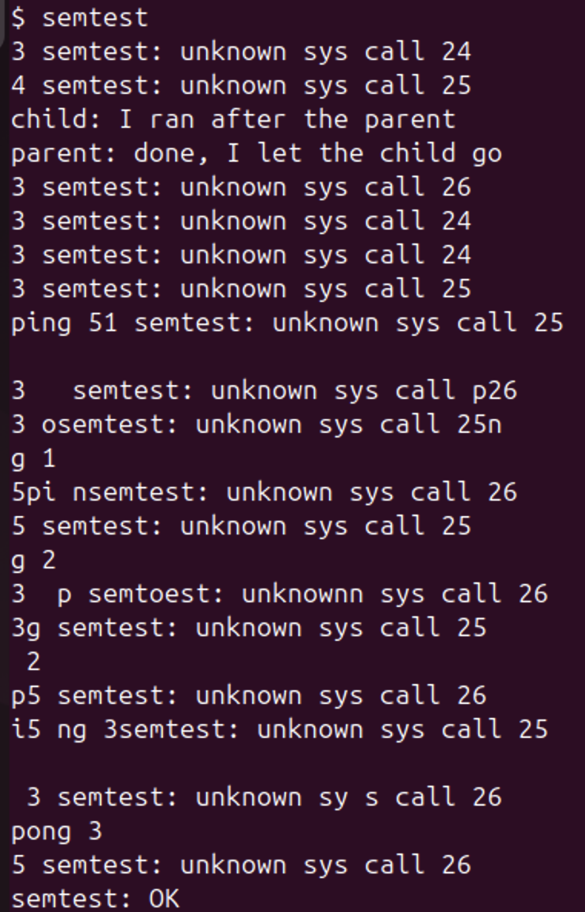
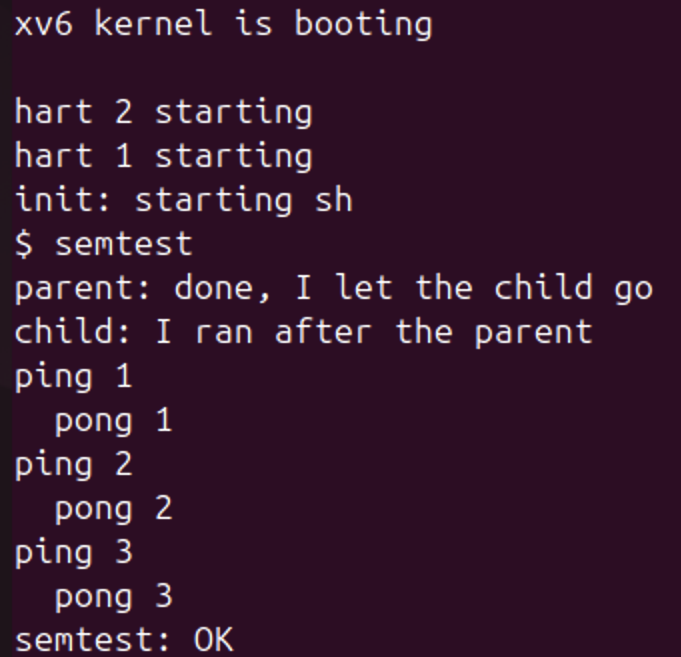
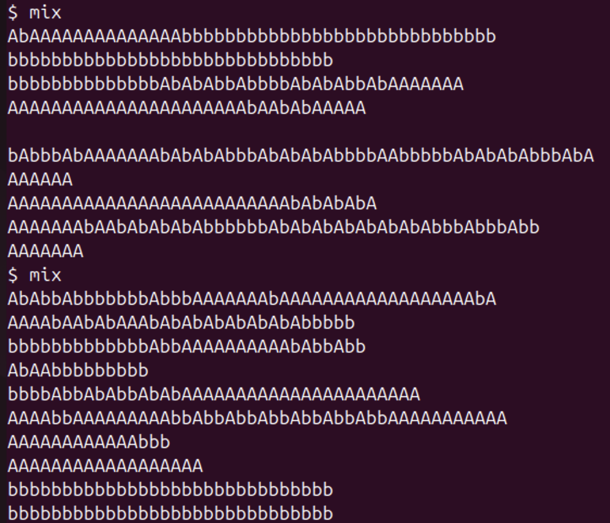
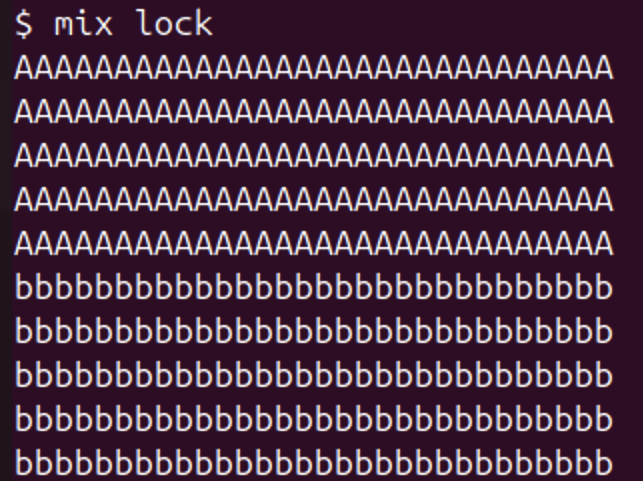
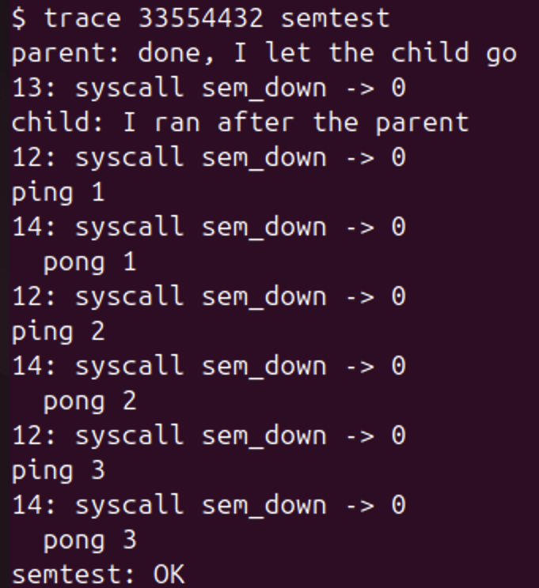
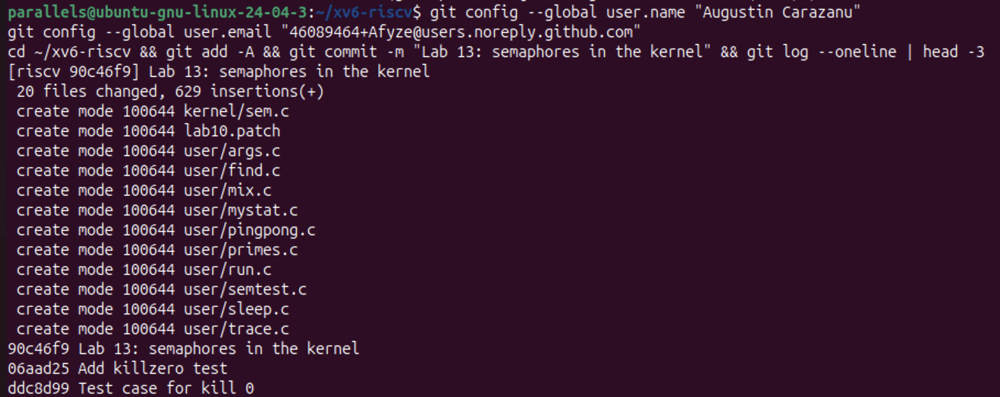

# Lab 13. Semaphores in Your Own Kernel

**Student:** Augustin Carazanu, FAF-243
**Environment:** Ubuntu 24.04.3 ARM64 (Parallels), `~/xv6-riscv` (course revision 06aad25, with `trace` from Lab 10 as number 23)

New system calls: `sem_init` (24), `sem_down` (25), `sem_up` (26).
Files here: `sem.c` (kernel), `semtest.c`, `mix.c`, the changed files `syscall.h`, `syscall.c`, `user.h`, `usys.pl`, `Makefile`, `lab13.patch` (only this lab's changes, on top of Lab 10), `git-log.txt` (commit `90c46f9` of my xv6 tree), `notes.txt` (the four Observe answers).

## Part 1. The numbers and the user side

Numbers in `kernel/syscall.h`, declarations in `user/user.h`, stubs in `user/usys.pl`, the programs `semtest.c` and `mix.c`, and `$U/_semtest\` `$U/_mix\` in `UPROGS`.

*Figure 1.1 – Check 1: `3 semtest: unknown sys call 24`, `4 semtest: unknown sys call 25`, and `child:` before `parent:`. Without semaphores the child did not wait; ping/pong mix with the error lines.*

## Part 2. The kernel side

`kernel/sem.c`: 8 semaphores, each a spinlock and a value. `sem_down` sleeps while the value is 0 (`sleep_prepare(s)`, `release`, `sleep()`, `acquire`), `sem_up` adds 1 and calls `wakeup(s)`. Plus `$K/sem.o` in `OBJS`, the externs and table entries in `syscall.c`, and the three names in the `trace` table. (I redid Part 2 with a script that removes every Part 2 line and adds each once; it printed the counts 1 and 6.)

*Figure 2.1 – Check 2: `parent` first, then `child` (asleep in `sem_down` during the 10 ticks), ping/pong strictly alternating, `semtest: OK`.*

## Part 3. A semaphore as a lock: mix

*Figure 3.1 – `mix` twice without the lock: the letters mix, differently each run.*

*Figure 3.2 – `mix lock`: 5 whole `A` lines, then 5 whole `b` lines.*

*Figure 3.3 – extra: `trace 33554432 semtest` (2^25 = only `sem_down`): the child (13) returns from `sem_down` only after `parent: done`, then ping (12) and pong (14) return in turn.*

*Figure 4.1 – the xv6 tree committed: `90c46f9 Lab 13: semaphores in the kernel`.*

## Observe

**1. Without the lock, why do the letters mix? (How many system calls does one line cost?)**
31: one `write()` per letter (30 letters + the new line). The two processes run on different CPUs, and between any two writes of one process the other can write its letters; nothing keeps the 31 writes of a line together.

**2. With the lock every line is whole. Which two lines of mix.c make one line a critical section?**
`if (uselock) sem_down(3);` before the letter loop and `if (uselock) sem_up(3);` after it. Semaphore 3 starts at 1, so it is a lock.

**3. In sem_down the test is "while (s->value == 0)", not "if". Why can a process wake up and still find 0?**
`wakeup(s)` wakes everyone sleeping on `s` but only one unit was given back, and between the wake-up and re-taking `s->lock` another process can take the unit. In `mix lock` the parent did exactly that: after `sem_up(3)` it looped straight back to `sem_down(3)` and took the unit before the child ran, so all `A` lines came first. The child woke, found 0, slept again; with `if` it would have made the value -1 and entered together with the parent.

**4. sem_down calls release(&s->lock) BEFORE sleep(). What would go wrong if it slept holding the spinlock?**
`sem_up` needs the same `s->lock` to add 1 and call `wakeup`, so it would spin forever and nobody could wake the sleeper: a deadlock. In our xv6 `sched()` would even stop the kernel with `panic("sched locks")`, because a process may sleep holding only its own `p->lock`. Releasing first is safe because `sleep_prepare(s)` already registered `s`: a `sem_up` in between clears `p->chan` and `sleep()` returns at once.

## Conclusions

A kernel semaphore is a number, a spinlock and sleep/wakeup on its address. Without it the child ran before the parent; with it the child slept in `sem_down` until `sem_up`, ping and pong took turns, and with start value 1 it kept each line of `mix` whole. The `while` re-check and releasing the spinlock before sleeping are what make it correct.
