# Purpose of the work

The purpose of this laboratory work is to check, on my own Linux system, how a file system works: the directory tree and the file types, inodes behind the names, hard and symbolic links, permissions, and the disks and kernel interfaces underneath. There is no programming in this lab. The work consists of commands, careful observation and short explanations.

The work was done on Ubuntu 24.04.3 ARM64, running in a Parallels virtual machine on Apple Silicon. Every command was run as the normal user `parallels`, not as root, because root ignores most permission checks.

# Part 1. The tree and the file types

`whoami` printed `parallels`, which confirms the normal user. The working folder `~/os-lab5` was created. `ls /` shows the top of the tree: `bin`, `boot`, `dev`, `etc`, `home`, `lib`, `proc`, `sys`, `tmp`, `usr`, `var` and others. On this Ubuntu system there are also the markers `bin.usr-is-merged`, `lib.usr-is-merged` and `sbin.usr-is-merged`, and the swap file `swap.img`.

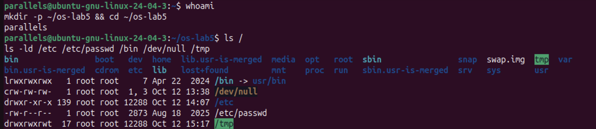

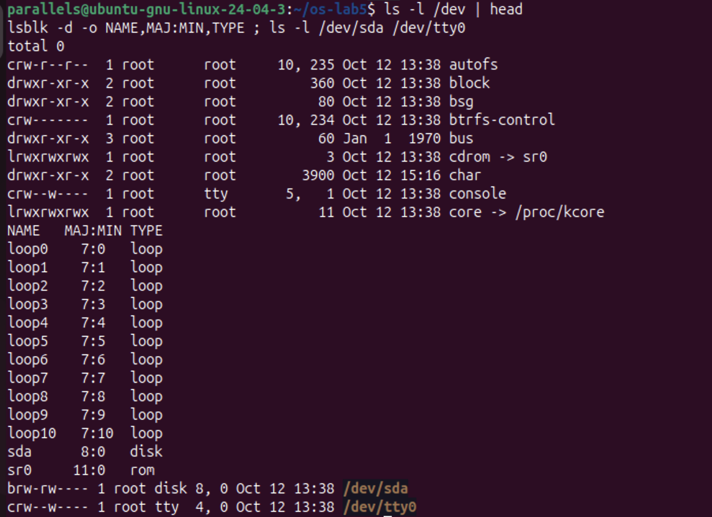

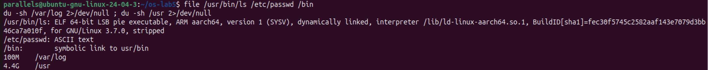

**Observe (1). The type of each path, from the first letter of `ls -l`:**

| Path | `ls -ld` output | First letter | Type |
|---|---|---|---|
| `/etc` | `drwxr-xr-x 139 root root 12288` | `d` | directory |
| `/etc/passwd` | `-rw-r--r-- 1 root root 2873` | `-` | regular file (text) |
| `/bin` | `lrwxrwxrwx 1 root root 7 ... /bin -> usr/bin` | `l` | symbolic link |
| `/dev/null` | `crw-rw-rw- 1 root root 1, 3` | `c` | character device |
| `/tmp` | `drwxrwxrwt 17 root root 12288` | `d` | directory, with the sticky bit `t` |

**Observe (2). What is /bin?**
`/bin` is not a directory. It is a **symbolic link to `usr/bin`**: `ls -ld` shows `/bin -> usr/bin`, and `file /bin` prints `symbolic link to usr/bin`. Modern Ubuntu "merged `/usr`", so the programs really live in `/usr/bin`. The link is only 7 bytes long, which is exactly the length of the text `usr/bin`.

**Observe (3). One character device and one block device in /dev:**
- **Character device:** `/dev/tty0` (`crw--w---- root tty 4, 0`), a terminal. `/dev/null` (`c`, major 1, minor 3) and `/dev/console` are character devices too. They transfer data as a stream of bytes.
- **Block device:** `/dev/sda` (`brw-rw---- root disk 8, 0`), the virtual 64 GB disk of the VM. A block device is read and written in fixed-size blocks.

Instead of a file size, devices show two numbers, the **major** and **minor** numbers (for example `8, 0`). The major number selects the kernel driver, and the minor number selects the exact device.

**Observe (4). Which is bigger, /var/log or /usr?**
`/usr` (4.4 GB) is much bigger than `/var/log` (100 MB), about **45 times** bigger, or roughly 4.3 GB more. `/usr` holds all installed programs and libraries, while `/var/log` holds only text log files.

`file` also identified `/usr/bin/ls` as `ELF 64-bit LSB pie executable, ARM aarch64`, a compiled program for this ARM CPU, and `/etc/passwd` as `ASCII text`.

# Part 2. Inodes and links

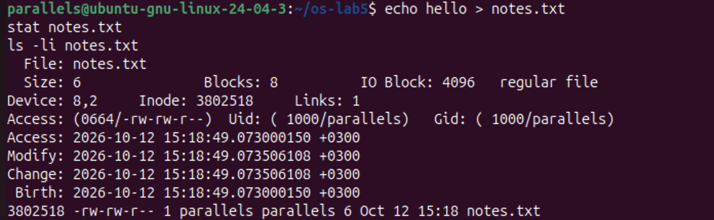

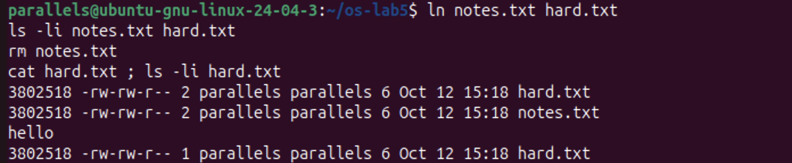

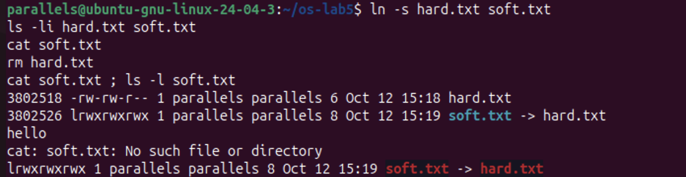

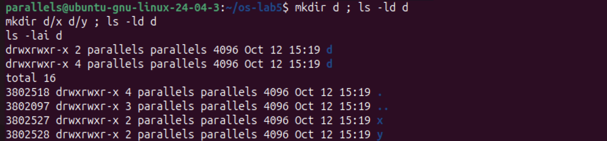

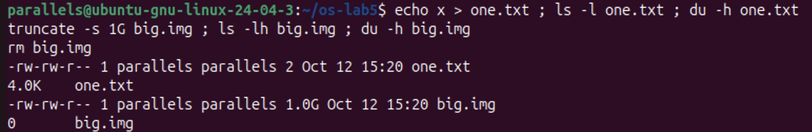

**Observe (1). Which number in `stat` is the inode, and which is the number of names?**
`stat notes.txt` printed `Inode: 3802518` and `Links: 1`. The **inode number** is 3802518, and `ls -li` shows the same number in its first column. **`Links`** is the number of names (directory entries) that point to this inode, which is 1 for a new file. The inode also stores the size (6 bytes), the blocks used (8 sectors of 512 bytes, so 4 KB), the permissions (`0664`), the owner (`1000/parallels`) and four timestamps. It does **not** store the file's name.

**Observe (2). Why could I still read hard.txt after `rm notes.txt`? What does `rm` really remove?**
`ln notes.txt hard.txt` created a second name for the **same inode**: both names show inode 3802518, and the link count became 2. `rm` does not delete the file's data. It removes **one name** (one directory entry) and decreases the link count by one. After `rm notes.txt`, the count dropped to 1, and `hard.txt` still pointed to the inode, so `cat hard.txt` printed `hello`. The kernel frees the inode and its blocks only when the link count reaches 0 and no process still has the file open.

**Observe (3). Why did `cat soft.txt` fail, and why is soft.txt 8 bytes?**
A symbolic link is a separate small file with its **own inode** (3802526, not 3802518). It contains only a **path**, the text `hard.txt`. When `hard.txt` was removed, the target name no longer existed. `cat soft.txt` followed the stored path and found nothing, so it printed `No such file or directory`, even though `soft.txt` itself still exists. `ls` shows the broken link in red.

The size of `soft.txt` is **8 bytes**, because `hard.txt` has exactly 8 characters. The link stores the target's name, not its data.

**Observe (4). A new directory has 2 links, and 4 after two subdirectories. Where does each come from?**
*Prediction:* 2, then 4. *Result:* `drwxrwxr-x 2 ... d`, then `drwxrwxr-x 4 ... d`, as predicted.
- Link 1 is the entry `d` in its parent directory (`~/os-lab5`).
- Link 2 is the entry `.` inside `d`, which points to `d` itself.
- Links 3 and 4 are the `..` entries inside `d/x` and `d/y`. Each subdirectory's `..` points back to `d`.

`ls -lai d` confirms it: `.` is inode 3802518 with 4 links, while `x` and `y` have 2 links each. So a directory's link count is always 2 plus its number of subdirectories.

The new directory `d` received inode **3802518**, the same number that `notes.txt`/`hard.txt` used before. That inode had been freed when its last name was removed, so the file system reused it.

**Observe (5). Why does a 2-byte file use 4.0K, and a 1 GB file use 0?**
- `one.txt` contains 2 bytes (`x` and a newline), but disk space is allocated in whole **blocks** of 4096 bytes. Even the smallest non-empty file takes one full block, so `du` reports **4.0K**.
- `truncate -s 1G big.img` only set the **size** recorded in the inode to 1 GB, without writing any data. This is a **sparse file**: no data blocks are allocated until something is written, so `ls -lh` shows `1.0G` while `du -h` shows `0`.

`ls` reports the size (the logical length), while `du` reports the space really used on disk.

# Part 3. Permissions

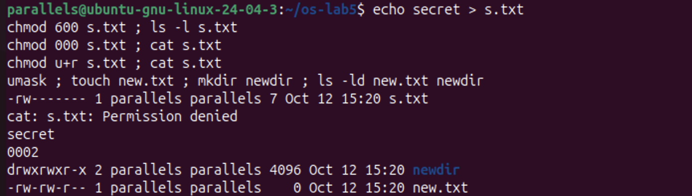

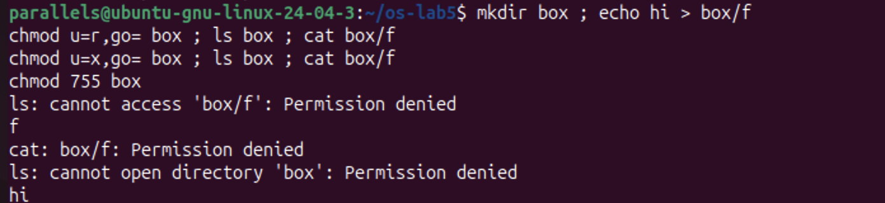

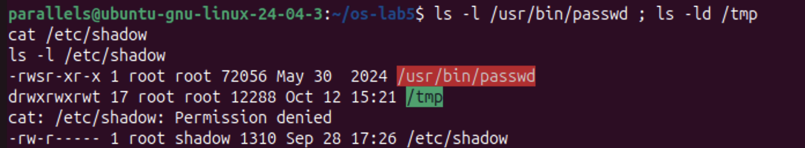

**Observe (1). 600, 644, 755 and 700 as rwx strings, with a real use for each:**

| Octal | rwx | Real use |
|---|---|---|
| 600 | `rw-------` | Private files that only the owner may read: `~/.ssh/id_rsa`, or `s.txt` in this lab |
| 644 | `rw-r--r--` | Ordinary public files: `/etc/passwd`, web pages, documents |
| 755 | `rwxr-xr-x` | Programs and directories everyone may use: `/usr/bin/*`, `/etc`, home folders |
| 700 | `rwx------` | Private directories or scripts: `~/.ssh`, a personal scripts folder |

Each octal digit is the sum of r = 4, w = 2 and x = 1, for the owner, the group and others in that order.

**Observe (2). With `chmod 000` I own the file but cannot read it. Why does ownership not help?**
The kernel checks the permission bits of the class that applies to me, and for the owner that is the first `rwx` triplet. With `000`, the owner's triplet is `---`, so the read was refused: `cat: s.txt: Permission denied`. Being the owner does not bypass the bits. It only gives me the right to **change** them with `chmod`, which I did with `chmod u+r`, and then `cat` printed `secret`. Only root ignores these bits.

**Observe (3). What is my umask, and how does it explain new.txt and newdir?**
The umask is **0002**, which removes the write permission for others. New files start from `666` and new directories from `777`, and the umask bits are then cleared:
- `new.txt`: 666 minus 002 gives **664**, `-rw-rw-r--`.
- `newdir`: 777 minus 002 gives **775**, `drwxrwxr-x`.

Files don't get `x` by default, because a new file is not normally a program.

**Observe (4). The box experiment: what do r and x mean on a directory?**
A directory is a list of (name → inode) entries.
- **`r` only** (`chmod u=r`): I can **read the list of names**. `ls box` printed `f`, but `ls` also said `cannot access 'box/f': Permission denied`, because it could not open the entry to read the inode's details. `cat box/f` was denied for the same reason.
- **`x` only** (`chmod u=x`): I can **pass through** the directory and use a name I already know, but not list it. `ls box` failed with `cannot open directory 'box'`, while `cat box/f` printed `hi`.

So `r` means "see which names exist", and `x` means "enter the directory and reach a file by name". To use a directory normally, both are needed (`755`).

*Prediction vs. result:* I predicted that with `r` only, `ls` would work completely. In fact it printed the name with an error, because `ls --color` also needs `x` to read each file's type.

**Observe (5). The `s` in /usr/bin/passwd and the `t` in /tmp:**
- `-rwsr-xr-x root root /usr/bin/passwd`: the **`s` (setuid)** in place of the owner's `x` means the program runs with the privileges of its **owner (root)**, not of the user who started it. `passwd` needs this because passwords are stored in `/etc/shadow` (`-rw-r----- root shadow`), which a normal user cannot read or write: `cat /etc/shadow` gave `Permission denied`. setuid lets any user change **their own** password through a trusted program, without being given access to the file itself.
- `drwxrwxrwt /tmp`: the **`t` (sticky bit)** means that in this directory, which everyone can write to, a file can be deleted or renamed only by its **owner** (or root). Users can share `/tmp` without deleting each other's files.

# Part 4. Disks and the kernel as files

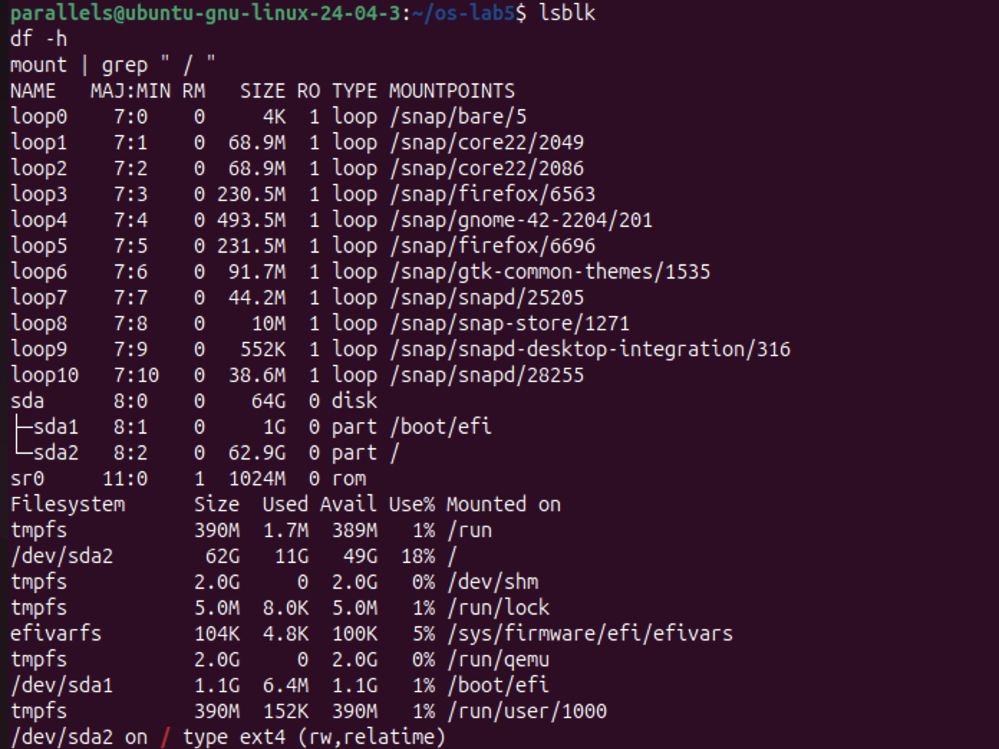

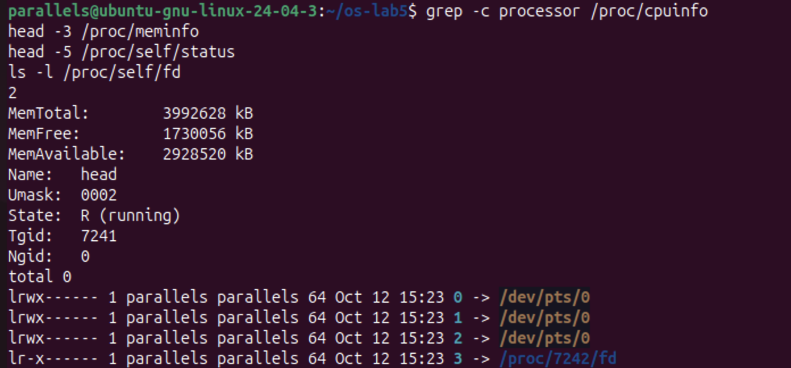

**Observe (1). My disk:**

```
sda  (8:0)  64 GB virtual disk (Parallels)
├── sda1 (8:1)    1 GB    mounted at /boot/efi   EFI system partition
└── sda2 (8:2)  62.9 GB   mounted at /           ext4  (rw,relatime)
sr0  (11:0)  virtual CD/DVD drive
loop0 … loop10  read-only snap packages, mounted under /snap/…
```

The root file system is `/dev/sda2`, formatted as **ext4** (`mount` printed `/dev/sda2 on / type ext4 (rw,relatime)`). The `loopN` devices are not real disks. They are image files (snap packages) that the kernel presents as block devices and mounts read-only.

**Observe (2). How full is the root file system?**
`df -h` shows `/dev/sda2 62G 11G 49G 18% /`, so **18% is used**: 11 GB used and 49 GB available. The other entries (`tmpfs` on `/run`, `/dev/shm` and others) live in RAM, not on the disk.

**Observe (3). CPU cores and RAM, according to /proc:**
`grep -c processor /proc/cpuinfo` printed **2**, so the VM has 2 CPU cores. `/proc/meminfo` shows `MemTotal: 3992628 kB`, about **3.8 GiB** (the 4 GB given to the VM, minus memory the kernel reserves), with `MemAvailable: 2928520 kB`. These are the resources the virtual machine gives to Ubuntu, not those of the whole Mac.

**Observe (4). /proc/self/status showed the name of a program. Which one, and why?**
It showed **`Name: head`**. `/proc/self` is a special link that always points to the directory of **the process that is reading it**. The file was opened by `head -5 /proc/self/status`, so "self" was `head` itself (PID 7241).

The next command proves the same idea. `ls -l /proc/self/fd` listed the open files of the `ls` process: 0, 1 and 2 (stdin, stdout and stderr) all point to the terminal `/dev/pts/0`, and descriptor 3 points to `/proc/7242/fd`, the directory `ls` itself had opened (PID 7242, the next process). The kernel's state appears as ordinary files, read with ordinary tools.

# Stretch tasks

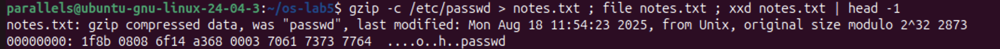

**(a) Magic numbers.** The compressed copy of `/etc/passwd` was saved as `notes.txt`, which has a misleading extension. `file` still recognized it: `gzip compressed data, was "passwd"`. `xxd` shows the first bytes `1f 8b 08 08 ...`. The bytes **`1f 8b`** are the gzip **magic number**, and `08` means the deflate compression method. `file` reads these bytes from the content and ignores the extension, because on Linux the name of a file does not determine its type.

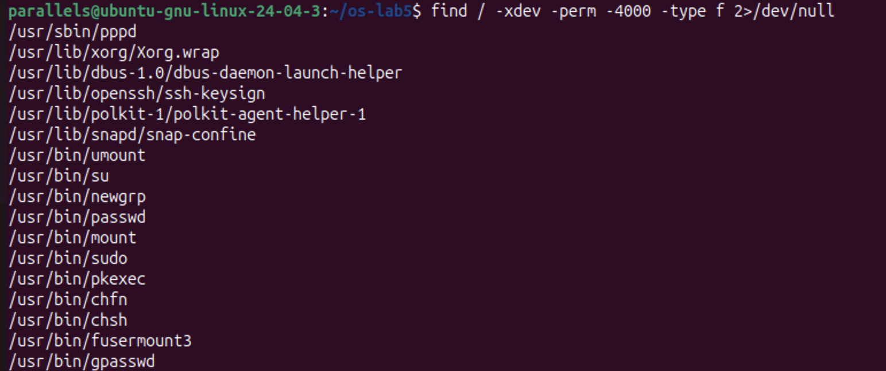

**(b) Hunting for setuid programs.** `find / -xdev -perm -4000 -type f` found 17 setuid-root programs. They include the classic ones from the lecture: `passwd`, `su`, `sudo`, `mount`, `umount`, `chsh`, `chfn`, `newgrp` and `gpasswd`. It also found ones specific to this desktop installation: `pkexec` and `polkit-agent-helper-1` (graphical admin prompts), `snap-confine` (snap packages), `fusermount3` (user-space file systems), `Xorg.wrap` (the display server), `dbus-daemon-launch-helper`, `ssh-keysign` and `pppd`. Each of them is a program that has to do one privileged task on behalf of a normal user, which is why the list is kept as short as possible.

# Conclusions

This laboratory work showed that a file **name** and a **file** are different things. The file itself is an **inode** that holds the size, owner, permissions and the location of the data, while names are only directory entries that point to it.

That explains everything observed:
- A **hard link** is a second name for the same inode, and `rm` only removes a name.
- A **symbolic link** is a separate tiny file that stores a path, so it breaks when the target is gone.
- A directory's link count comes from its own `.` and each child's `..`.
- The **size** of a file and the **space** it uses differ, because of 4 KB blocks and sparse files.

Permissions are checked by the kernel on every access, even against the owner. On a directory, `r` lists the names and `x` lets you reach them. The **umask** sets the default permissions of new files, and the special bits **setuid** and **sticky** solve two real problems: changing a password without access to `/etc/shadow`, and sharing `/tmp` safely.

Finally, the disk itself (`/dev/sda`, partitioned into an EFI partition and an ext4 root partition at 18% use) and the running kernel (`/proc/cpuinfo`, `/proc/meminfo`, `/proc/self`) are all presented as files. This is the Unix idea that "everything is a file", seen directly.
