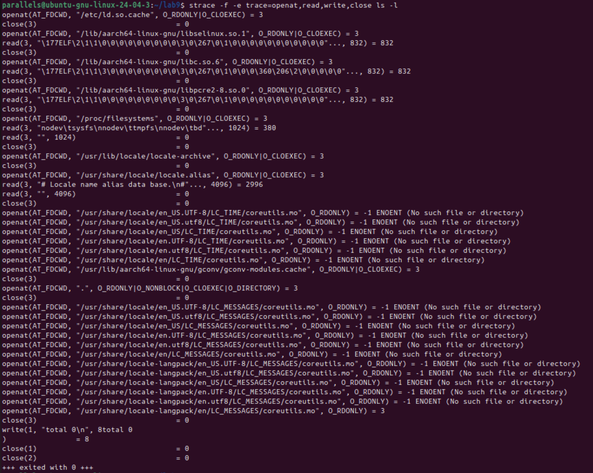
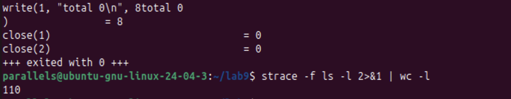
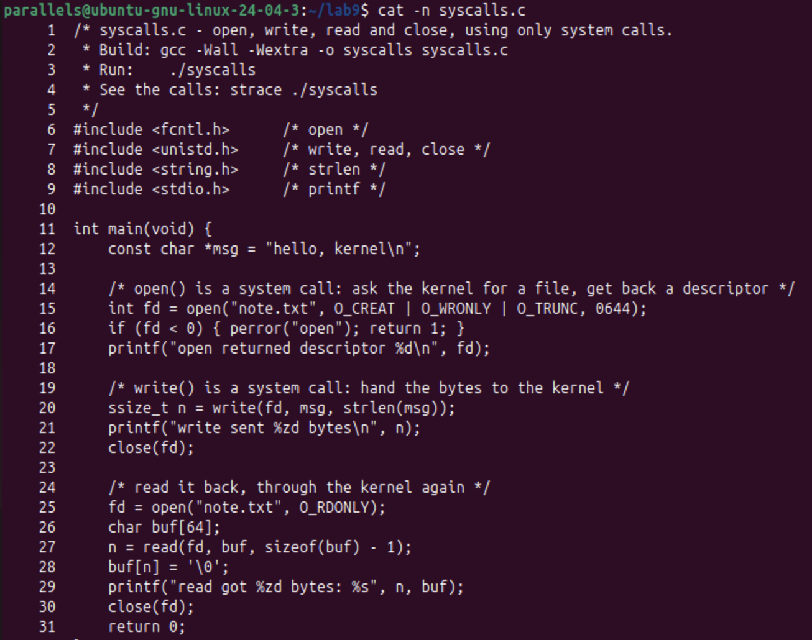
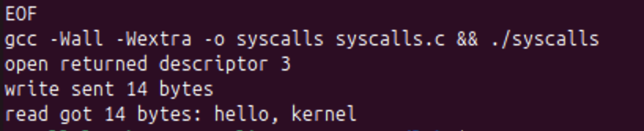
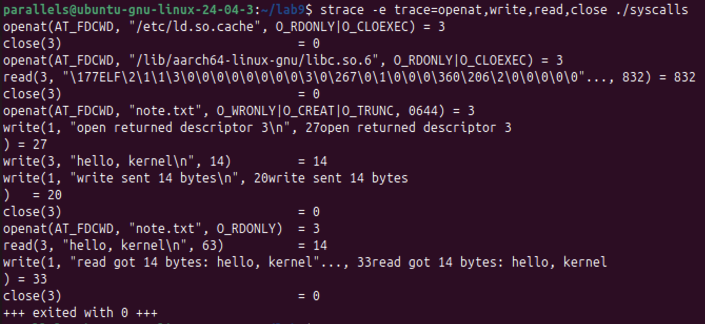
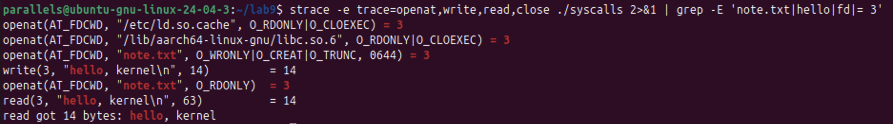
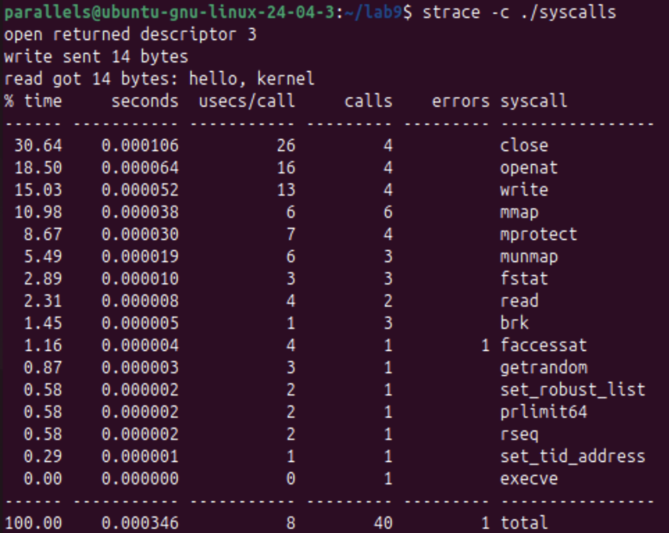

# Lab 9. Watching System Calls with strace

**Student:** Augustin Carazanu, FAF-243
**Environment:** Ubuntu 24.04.3 ARM64 in Parallels, strace 6.8, folder `~/lab9`

## Part 1. See the calls of a real command

```
strace -f -e trace=openat,read,write,close ls -l
```



*Figure 1.1 – strace of `ls -l` in an empty folder.*

**How many system calls does one simple `ls` make?**

```
strace -f ls -l 2>&1 | wc -l
110
```



*Figure 1.2 – the unfiltered trace has 110 lines, so `ls` makes roughly a hundred system calls, even for an empty folder. Only one of them produces the output.*

**Observe. Which system call does `ls` use to print to the screen? To which descriptor does it write?**

`ls` uses **`write`**, to **descriptor 1** (standard output): `write(1, "total 0\n", 8) = 8`. The 8 bytes are `total 0` and the newline. `ls` does not know that descriptor 1 is the screen: the shell set it up before `ls` started.

## Part 2. A program that calls the kernel directly



*Figure 2.1 – `syscalls.c` listed with `cat -n` (the file is in this folder).*

```
gcc -Wall -Wextra -o syscalls syscalls.c
./syscalls
```



*Figure 2.2 – no warnings; descriptor 3, 14 bytes written, 14 bytes read.*

```
strace -e trace=openat,write,read,close ./syscalls
```



*Figure 2.3 – my calls: `openat(... "note.txt" ...) = 3`, `write(3, "hello, kernel\n", 14) = 14`, `close(3)`, `openat(... "note.txt", O_RDONLY) = 3`, `read(3, "hello, kernel\n", 63) = 14`, `close(3)`. The three `write(1, ...)` lines are the `printf` calls.*



*Figure 2.4 – the same trace filtered with `grep -E 'note.txt|hello|fd|= 3'`.*

**Observe. The descriptor returned by the first `openat` is 3, not 0, 1 or 2. Why are those three already taken?**

Every process starts with three descriptors open: **0 (stdin), 1 (stdout) and 2 (stderr)**. The shell prepares them before the program starts, and `fork` and `exec` keep them, so `./syscalls` inherits the terminal as 0, 1 and 2. `open` always returns the **smallest free number**, which is 3. The trace shows the rule: after `close(3)` the next `openat` returns 3 again.

## Part 3. Count one kind of call

The lab sheet lists this part in its overview but gives no commands for it. I used `strace -c ./syscalls`, which counts the calls.



*Figure 3.1 – 40 calls in total: `openat` 4, `close` 4, `write` 4, `read` 2, `mmap` 6, and one failed `faccessat` of the start-up. Only 9 of the 40 calls come directly from my code (2 `openat`, 2 `close`, 1 `read`, 4 `write`); the rest are the program starting up.*
